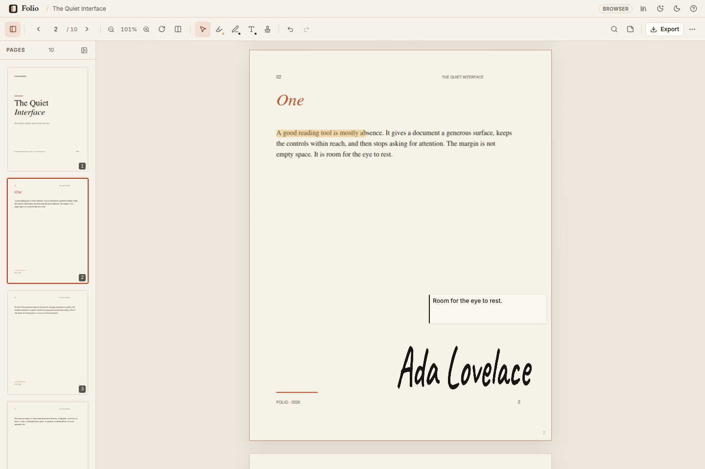
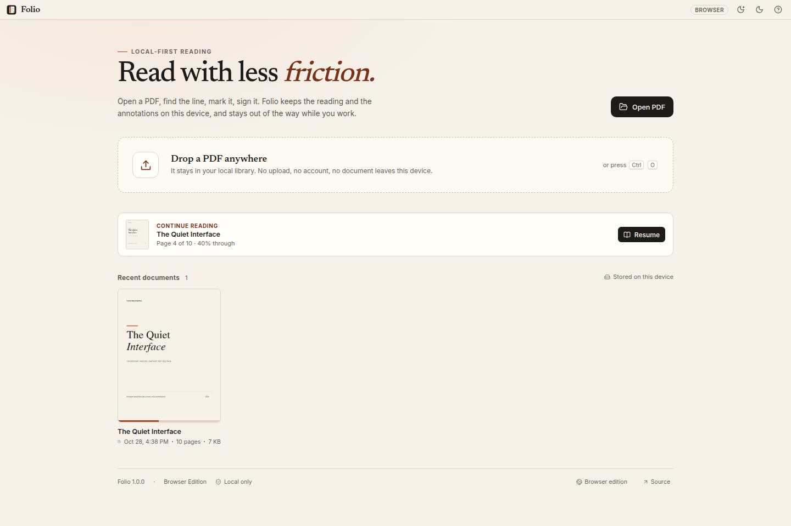
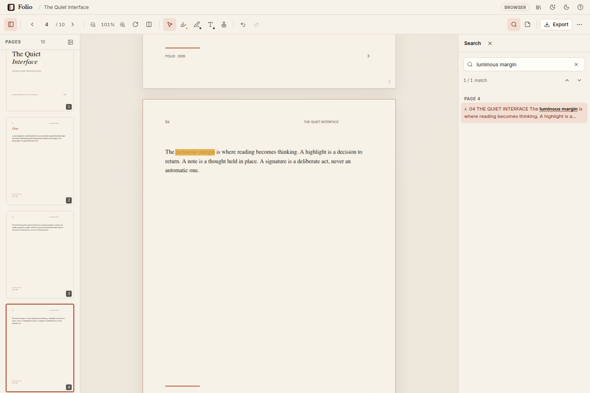
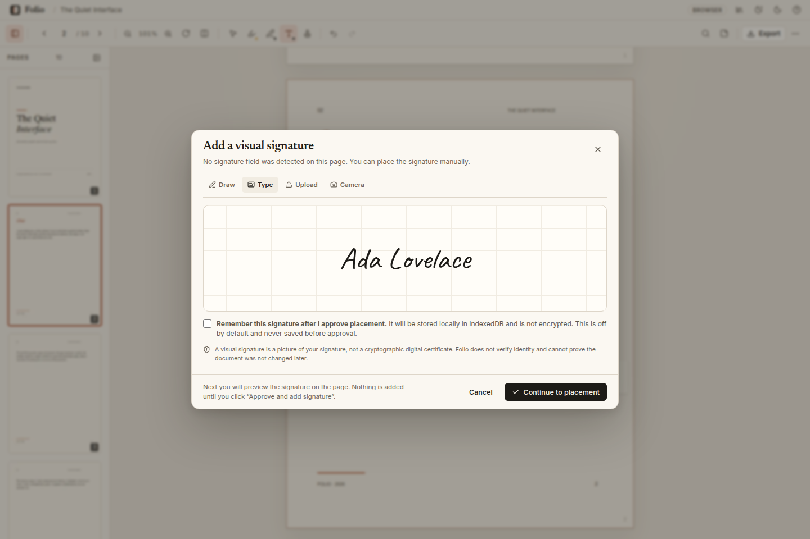
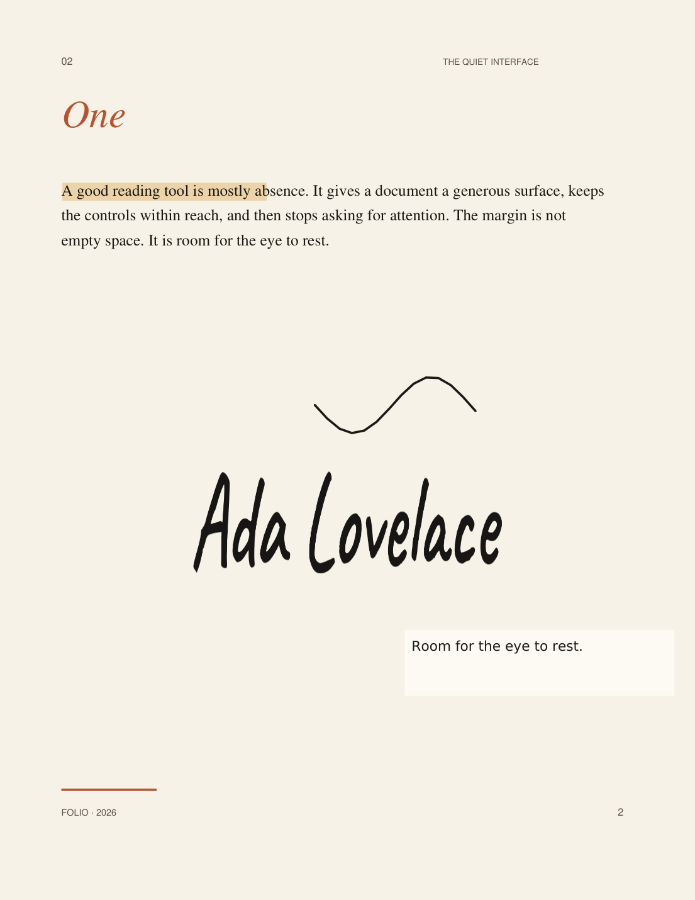

# Folio


**A calm, local-first PDF reader and annotation app for Windows — with a browser twin.**

Open a PDF, read it without friction, find the line that matters, mark it, sign it, and export a real annotated PDF. Folio keeps documents, annotations, sessions, and reusable signatures on the device. No account, upload, or telemetry.

[](https://github.com/gerrcass/folio-pdf-app/actions/workflows/ci.yml)
[](https://gerrcass.github.io/folio-pdf-app/)
[](https://github.com/gerrcass/folio-pdf-app/actions/workflows/windows.yml)
[](LICENSE)

**[Open the Browser Edition →](https://gerrcass.github.io/folio-pdf-app/)** · **[Download the Windows build →](https://github.com/gerrcass/folio-pdf-app/releases/latest)**



## What is in the box

- **A real reader.** Continuous virtualized pages, thumbnails, precise navigation, zoom, fit width/page, rotation, two-page spreads, focus mode, document information, and printing.
- **Search that stays responsive.** Background text indexing over a 300-page fixture completes in roughly 2.5 seconds on the reference machine; the input can still be typed in while pages are indexed. Results stream in with page-grouped snippets and active-match highlighting.
- **Annotations that survive.** Multi-color highlights, freehand ink, colored text notes, undo/redo, a selection inspector, and an annotation panel. Geometry is stored in PDF user space, so zoom, Viewer Rotation, Page Rotation, and nonzero CropBox origins do not move your marks.
- **Signatures with a deliberate pause.** Draw, type, upload, or camera-capture a signature. Folio detects unsigned signature widgets and likely labels on the current page, shows a movable/resizable preview, and adds nothing until you click **Approve and add signature**. Signatures export as transparent native PDF `/Stamp` annotations.
- **Native export.** `Highlight`, `Ink`, `FreeText`, and `Stamp` annotations are written with appearance streams. Text stays selectable. Repeated exports are byte-identical for the same source state and do not accumulate annotations.
- **Reading memory.** Page, scroll position, zoom, rotation, sidebar, spread mode, window bounds, interface theme, and Night Reading survive restarts. An explicitly opened file always wins over automatic restoration; returning to the Library prevents the next auto-open.
- **A secure Electron shell.** Context isolation, sandboxing, no renderer Node integration, a narrow preload bridge, an `app://folio` production origin, validated IPC, navigation denial, and video-only camera permission scoped to the trusted window.
- **Honest editions.** Installed, Portable, Development, and Browser editions identify themselves; only the Installed Edition can self-update, and only when a distributor configures an update feed.

## Install and run

### Windows

The Windows installer and portable build are produced by the [Windows Installer workflow](https://github.com/gerrcass/folio-pdf-app/actions/workflows/windows.yml) and attached to the [latest release](https://github.com/gerrcass/folio-pdf-app/releases/latest).

- **Installed Edition** — NSIS assisted installer, per-user by default, PDF file association, Start Menu shortcut, optional desktop shortcut, stable application ID for in-place upgrades.
- **Portable Edition** — unpacked build. It identifies itself as portable and does not offer self-update.

The installer is currently **unsigned**. Windows SmartScreen or an elevation prompt may appear; that prompt comes from Windows, not a Folio failure. No update feed is configured or published by this repository.

### Browser

Open **[https://gerrcass.github.io/folio-pdf-app/](https://gerrcass.github.io/folio-pdf-app/)**. The Browser Edition has the same reading, search, annotation, signature, and export core, with browser file picking instead of OS integration and no self-update. Recent documents are cached in that browser profile's IndexedDB.

### From source

Requires Node.js 22.12+.

```bash
npm install
npm run dev        # Electron + Vite
npm run dev:web    # Browser-only development
```

Other useful commands:

```bash
npm run typecheck
npm run lint
npm test          # Vitest: geometry, search, history, signatures, storage, export, print ranges
npm run test:e2e  # Playwright: real browser flows and native export
npm run test:electron
npm run build:web # static Browser Edition
npm run build     # desktop renderer + Electron bundles
npm run dist:win  # NSIS + portable targets (Windows or Wine)
npm run bench     # regenerates docs/performance.md
npm run screenshots
```

## Design and behavior

- Warm off-white and near-black themes, bundled Inter / Newsreader / Caveat typography, subtle borders, compact controls, and visible focus states.
- Night Reading is a page-only treatment, independent of the interface theme, persisted immediately, and restored independently.
- The custom Windows title bar is frameless with working minimize, maximize/restore, and close controls. Window bounds are validated against the available monitors.
- The reader renders only near-viewport pages through an intersection observer and a two-slot render queue, caps canvas DPR at 2, caches a bounded set of canvases, cancels stale work on scroll/document/rotation changes, and defers sharp zoom redraws while updating layout immediately.
- A single IndexedDB connection is shared by the library, sessions, annotations, and remembered signatures. The cached library is bounded to 24 documents / 200 MB, evicting the least-recently-opened cached bytes except the open document. Annotation records are keyed by fingerprint and survive cache eviction; only an explicit Remove from Library deletes them.
- PDFs, page images, signatures, and camera frames never leave the device. There are no runtime network requests required for reading, annotating, signing, exporting, or printing.

Further detail: [spec](docs/specs/folio-1.0.md) · [ADRs](docs/adr/) · [design grill](docs/design/grill-session.md) · [review round 1](docs/design/review-round-1.md) · [review round 2](docs/design/review-round-2.md) · [agent brief](AGENTS.md) · [coding standards](CODING_STANDARDS.md) · [performance baseline](docs/performance.md).

## Signatures, plainly

A Folio signature is a **visual signature image**, not a digital certificate. Folio does not verify identity, create a cryptographic signature, or guarantee that later edits are detectable. The UI says this in the signature flow and in About Folio.

When a PDF already contains digital signatures, Folio detects them, suppresses automatic field suggestions, and warns that editing may affect their validity. It does not claim to preserve or validate those signatures.

Remembering a signature is **off by default**. It takes effect only after Approval, stores the image locally in IndexedDB, warns that the data is not encrypted at rest, and offers **Forget saved signature**. Camera capture is video-only, user-initiated, and stops its tracks on capture, close, cancel, and unmount.

## Updates

`electron-updater` is loaded only for the installed, packaged edition. The feed is read at runtime from `FOLIO_UPDATE_URL` or an `update-config.json` in the resources directory (see `build/update-config.example.json`). The repository deliberately publishes **no** feed. Development, Browser, and Portable editions never offer self-update. Restart is blocked while Folio is still saving annotations.

## Testing and evidence

The suite covers:

- PDF user-space conversion at page rotations 0/90/180/270, Viewer Rotation, and a nonzero CropBox origin.
- Search snippets, incremental indexing, counts, and grouping.
- Annotation history undo/redo and data-model updates.
- Signature widget/label detection and label de-duplication.
- IndexedDB eviction, session persistence, and annotation round-trips.
- Native export with appearance streams, transparent stamps, existing-form preservation, repeated exports, and encrypted-document failure.
- End-to-end browser flows for opening, navigation, search, annotations, signature approval, camera cleanup, remembered signature opt-in/forget, password retry/cancel, theme/Night Reading persistence, rotated-page selection, session restore, and the Library’s no-auto-reopen rule.
- Electron smoke and session-precedence tests in an isolated user-data directory.

The measured 300-page baseline is in [`docs/performance.md`](docs/performance.md). It is regenerated by `npm run bench`; it is not a CI performance gate. Do not cite a number without the corresponding artifact.

## Screenshots

| Library | Search |
| --- | --- |
|  |  |

| Signature flow | Native export |
| --- | --- |
|  |  |

## Out of scope

OCR and scanned-field detection beyond conservative text-label heuristics; cryptographic signing or certificate validation; cloud sync/accounts/collaboration; redaction; form filling beyond signature stamps; editing pre-existing third-party annotations; plugins; EPUB/Office; text reflow; macOS/Linux installers; true OS fullscreen (Focus mode hides the chrome); and publishing an update feed. Text-note export embeds DejaVu Sans, which covers Latin extended, Greek, Cyrillic, and monochrome emoji, but not CJK glyphs; CJK notes still display in the app. The full boundary is in the [spec](docs/specs/folio-1.0.md).

## License

MIT. See [LICENSE](LICENSE).
